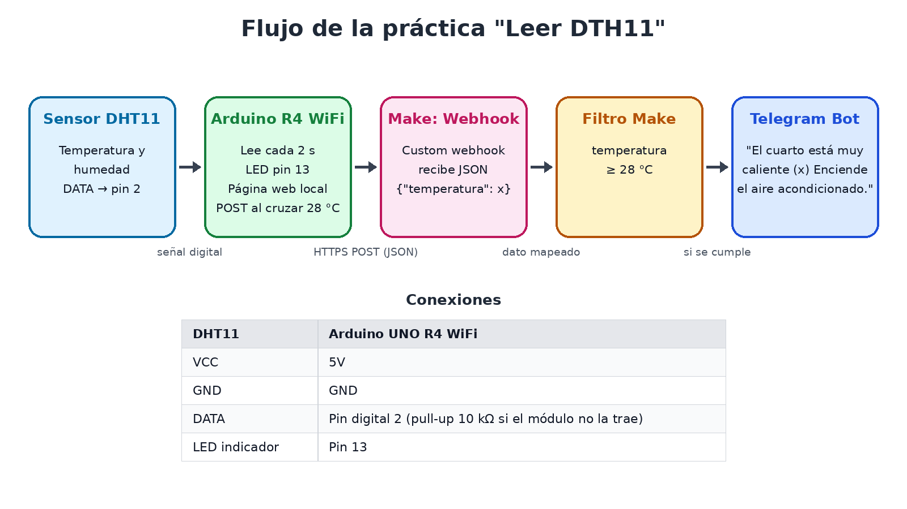
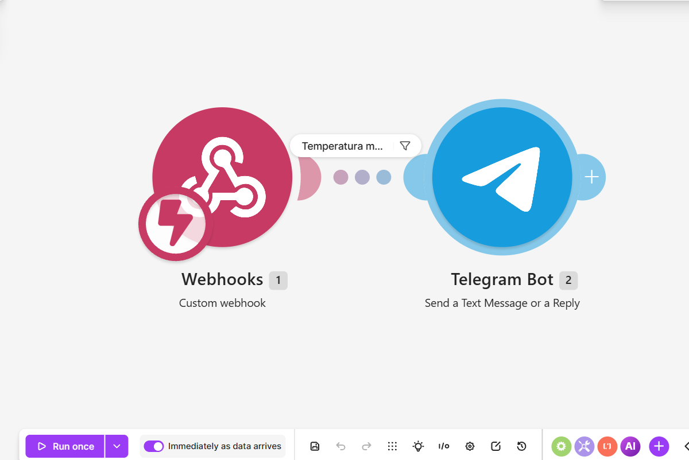
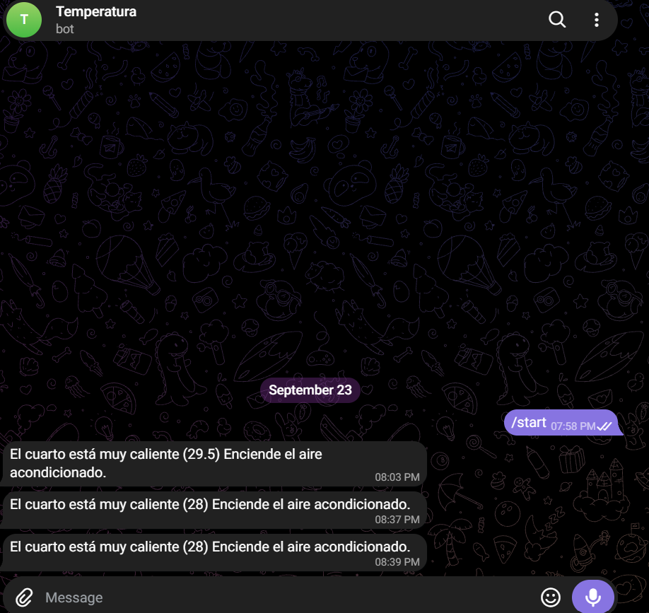

# Arduino_Leer_DTH11_Make_Telegram
Sistema de alerta por temperatura: Arduino UNO R4 WiFi + sensor DHT11 + Make.com + Telegram

| | |
|---|---|
| **Alumno** | Christian Paul Lizarraga Oronia |
| **Carrera** | Ingeniería en Sistemas Computacionales |
| **Materia** | Desarrollo Sustentable con Automatización |
| **Profesor** | Miguel Ángel Barrón Hernández |
| **Institución** | Instituto Tecnológico de Mazatlán (TecNM) |
| **Fecha de prueba** | 23 de septiembre de 2026 |

---

## Descripción
Un Arduino UNO R4 WiFi lee la temperatura y la humedad del cuarto con un sensor DHT11 cada 2 segundos. Si la temperatura llega o pasa de **28 °C**, enciende el LED del pin 13 y manda **una sola** petición HTTPS POST en formato JSON (`{"temperatura": valor}`) a un **Webhook de Make.com**. El escenario de Make revisa el dato con un **filtro** (temperatura ≥ 28 °C) y, si se cumple, el **Telegram Bot** envía el mensaje:

> El cuarto está muy caliente (*temperatura*) Enciende el aire acondicionado.

Además, el Arduino sirve una página web local (misma red WiFi) que muestra en vivo la temperatura, la humedad y el estado ("Normal" o "CALIENTE (LED encendido)"), y se actualiza sola cada 5 segundos.

## Objetivos de aprendizaje
**General:** construir un sistema de alerta automática que detecte temperatura elevada con un DHT11 y avise por Telegram mediante un escenario de Make.com activado desde el Arduino UNO R4 WiFi.

**Específicos:**
- Leer temperatura y humedad con el DHT11 desde el Arduino UNO R4 WiFi.
- Configurar un Webhook personalizado en Make.com como disparador (trigger).
- Enviar los datos del Arduino a Make en JSON mediante HTTPS.
- Configurar el módulo Telegram Bot para mandar la alerta con el valor real de temperatura.
- Entender cómo el Arduino y Make quedan sincronizados para reaccionar en tiempo real.

## Material utilizado
- Arduino UNO R4 WiFi
- Sensor de temperatura y humedad DHT11
- LED indicador en el pin 13
- Cables Dupont y protoboard
- Cable USB-C y computadora con Arduino IDE (librerías *DHT sensor library* y *Adafruit Unified Sensor*)
- Red WiFi de 2.4 GHz
- Cuenta de Make.com (zona us2.make.com)
- Bot de Telegram creado con @BotFather

## Diagrama del circuito y del flujo


| DHT11 | Arduino UNO R4 WiFi |
|---|---|
| VCC | 5V |
| GND | GND |
| DATA | Pin digital 2 |
| LED indicador | Pin 13 |

## Escenario en Make.com
El escenario **"Leer DTH11"** tiene dos módulos en secuencia y un filtro entre ellos:



| # | Módulo | Configuración |
|---|---|---|
| 1 | **Webhooks → Custom webhook** (trigger) | Webhook "Leer DTH11 webhook", máximo 1 resultado. Dato detectado: `temperatura` (number). |
| — | **Filtro** "Temperatura mayor o igual a 28 °C" | Condición: `{{1.temperatura}}` *número mayor o igual que* `28` |
| 2 | **Telegram Bot → Send a Text Message or a Reply** | Conexión "Temperatura". Texto: `El cuarto está muy caliente ({{1.temperatura}}) Enciende el aire acondicionado.` |

El escenario está en modo **"Immediately as data arrives"** (activo), así que reacciona en cuanto llega la petición del Arduino, sin abrir Make.

### Cómo se "escuchan" el Arduino y Make
- El Arduino no está conectado todo el tiempo con Make: solo hace la petición cuando hay algo que avisar, y Make espera en la URL del Webhook.
- El nombre del campo del JSON (`temperatura`) es exactamente el mismo que detectó Make; si no, Telegram no puede usar el dato.
- El host (`hook.us2.make.com`) y la ruta del código son los mismos que la URL del Webhook.
- El Arduino solo envía la alerta **cuando la temperatura cruza el umbral** (de "normal" a "caliente"), no en cada lectura, para no llenar el chat de mensajes repetidos.

## Código
- Código de Arduino: [Leer_DTH11_Make_Telegram.ino](Codigo/Leer_DTH11_Make_Telegram.ino)
- Blueprint del escenario de Make: [blueprint.json](Codigo/blueprint.json) (se puede importar en Make desde *Import Blueprint*)

> Por seguridad, en el `.ino` se reemplazaron el nombre y la contraseña del WiFi y la ruta del webhook por textos de ejemplo.

Partes clave del código:
```cpp
const float UMBRAL_TEMP = 28.0;

bool estaCalienteAhora = (temperatura >= UMBRAL_TEMP);
digitalWrite(ledPin, estaCalienteAhora ? HIGH : LOW);

// Solo se avisa a Make cuando se cruza el umbral
if (estaCalienteAhora && !estadoCaliente) {
  enviarAlertaMake(temperatura);
}
estadoCaliente = estaCalienteAhora;
```
```cpp
String jsonPayload = "{\"temperatura\":" + String(temp) + "}";
client.println("POST " + String(webhookPath) + " HTTP/1.1");
client.println("Host: " + String(host));
client.println("Content-Type: application/json");
```

## Video del funcionamiento
### [▶ Aquí está el video de la prueba en vivo (clic para verlo en YouTube)](https://www.youtube.com/shorts/RH5SxQN8CvE)

El enlace también está guardado en [video/enlace.txt](video/enlace.txt).

## Evidencias
**Alertas recibidas en Telegram (23 de septiembre de 2026):**



| Hora | Temperatura recibida | Mensaje |
|---|---|---|
| 20:03 | 29.5 °C | El cuarto está muy caliente (29.5) Enciende el aire acondicionado. |
| 20:37 | 28 °C | El cuarto está muy caliente (28) Enciende el aire acondicionado. |
| 20:39 | 28 °C | El cuarto está muy caliente (28) Enciende el aire acondicionado. |

Primero se envió `/start` al bot (19:58) para que Telegram le permitiera escribir al chat.

## Resultados
[Resultados.pdf](Resultados/Resultados.pdf): lo que se aprendió en esta práctica.

- El sistema funcionó de punta a punta: sensor → Arduino → Webhook → filtro → Telegram.
- Los tres mensajes llevan el valor real de temperatura enviado por el Arduino.
- Las alertas de las 20:37 y 20:39 muestran que, cuando la temperatura está justo en el umbral (28 °C), un pequeño cambio hacia abajo y otra vez hacia arriba cuenta como un nuevo cruce y manda otra alerta.

## Preguntas de reflexión

**1. ¿Por qué el Arduino solo manda la alerta cuando la temperatura cruza el umbral y no en cada lectura?**
Porque el sensor se lee cada 2 segundos. Si se mandara en cada lectura, mientras el cuarto siguiera caliente llegarían unos 30 mensajes por minuto a Telegram y se gastarían operaciones de Make, datos y energía sin necesidad. Guardar el estado anterior (`estadoCaliente`) permite avisar solo cuando algo cambia.

**2. Si el Arduino ya compara con 28 °C, ¿para qué sirve el filtro en Make?**
Es una segunda validación. Si llega al Webhook un dato equivocado o una prueba manual con una temperatura baja, el filtro evita que se mande una alerta falsa. Además, la regla queda visible en el escenario y se puede cambiar desde Make sin volver a programar el Arduino.

**3. ¿Por qué llegaron dos alertas de 28 °C con dos minutos de diferencia?**
La temperatura estaba justo en el límite. El DHT11 tiene una precisión de ±2 °C, así que la lectura puede pasar de 28 a 27 y regresar a 28. El código entiende eso como "bajó y volvió a subir" y manda otra alerta. Se puede evitar con **histéresis**: por ejemplo, avisar al llegar a 28 °C y solo "rearmar" la alerta cuando baje de 27 °C.

**4. ¿Cómo se relaciona esta práctica con el desarrollo sustentable?**
El sistema propone encender el aire acondicionado **solo cuando de verdad hace falta**, en lugar de dejarlo prendido todo el día, y eso reduce el consumo eléctrico y las emisiones. También es un ejemplo de *Green IT*: una placa de bajo consumo que trabaja por eventos (solo se comunica cuando hay algo que avisar), así que genera poco tráfico de red y usa pocas ejecuciones en la nube.

**5. ¿Qué pasaría si el nombre del campo del JSON no coincidiera con el que detectó Make?**
El Webhook recibiría la petición, pero `{{1.temperatura}}` quedaría vacío: el filtro no se cumpliría y el mensaje no se enviaría o saldría sin el número. Por eso el campo del Arduino y el de Make tienen que llamarse exactamente igual.

**6. ¿Qué cuidados de seguridad hay que tener al publicar este proyecto?**
El código original tiene la contraseña del WiFi y la URL del Webhook. Cualquiera que tenga esa URL puede mandar mensajes al bot. Por eso en este repositorio se reemplazaron por textos de ejemplo.

**7. ¿Qué mejoras se le podrían hacer?**
- Agregar histéresis para evitar alertas repetidas en el límite.
- Mandar también un aviso cuando la temperatura vuelva a la normalidad ("ya puedes apagar el aire").
- Incluir la humedad en el mensaje o calcular el índice de calor.
- Guardar las lecturas en Google Sheets desde Make para tener un historial y graficar el consumo.
- Controlar el aire acondicionado directamente con un relé o un control IR.

## Conclusiones
La práctica permitió unir un sensor físico con servicios en la nube sin montar un servidor propio: el Arduino actúa como cliente que solo se comunica cuando detecta un cambio, y Make funciona como puente entre el dato y la notificación. Se reforzó la importancia de que ambos lados coincidan (URL, nombre del campo, formato JSON) y de que el escenario esté activo para reaccionar en tiempo real. Desde el punto de vista sustentable, este tipo de automatización ayuda a usar la energía de forma más eficiente, porque el equipo de enfriamiento se enciende solo cuando es necesario.
